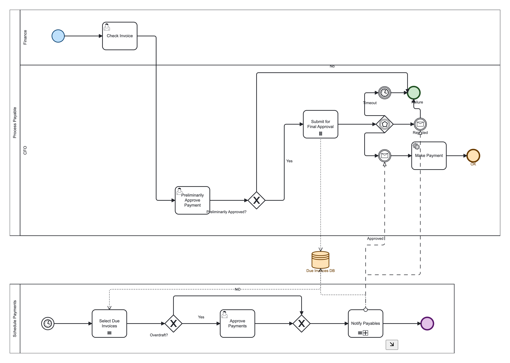

# Accounts Payable: complete JSON to BPMN example

This example demonstrates how `json-to-bpmn-xml` turns a structured workflow model into a BPMN 2.0 collaboration diagram with automatic layout. The input is the existing [`accountsPayable` fixture](https://github.com/ehisamed/json-to-bpmn-xml/blob/main/fixtures/models/accounts-payable.ts), also exercised by repository tests.



## Input and output

- [Complete JSON input](./examples/accounts-payable.json): a plain JSON `ProcessModel`, with no TypeScript imports or omitted fields.
- [Generated BPMN XML](./examples/accounts-payable.bpmn): process elements, collaboration, shapes and edge waypoints. Download the raw file and open it in a BPMN viewer such as [bpmn.io](https://demo.bpmn.io).
- [Typed source fixture](https://github.com/ehisamed/json-to-bpmn-xml/blob/main/fixtures/models/accounts-payable.ts): the maintained source of the input.

The JSON and BPMN files are included in the npm package under `docs/examples/`. Fixtures and tests are available in the source repository.

## Business scenario

The **Process Payable** pool has Finance and CFO lanes. Finance checks the invoice; the CFO gives preliminary approval. Rejection ends the path. Approval submits the invoice for final approval and writes to the Due Invoices DB. An event-based gateway then waits for a timer, an approval message or a rejection message. Approval leads to Make Payment; rejection and timeout lead to a shared end event.

The **Schedule Payments** pool starts with a timer event, reads due invoices and checks for overdraft. One branch requests approval; the other bypasses that task. Both lead to Notify Payables, a collapsed subprocess that updates the shared store and sends messages to Process Payable.

## What this fixture demonstrates

| Input | Generated BPMN / diagram |
| --- | --- |
| `processes` with participant names | 2 processes and 2 participant pools |
| `lanes` and node `laneId` | 2 lanes with flow-node references and cross-lane routes |
| Process `nodes` / `edges` | 19 nodes and 20 sequence flows with DI coordinates |
| `exclusiveGateway` | Conditional branching illustrated by named outgoing flows |
| `eventBasedGateway` and timer / message catches | An event-based gateway and event definitions |
| `messageFlows` | 2 message flows between pools |
| `dataStores`, `dataInputs`, `dataOutputs` | 1 shared data store and 3 data associations |
| `multiInstance: true` / `{ sequential: true }` | Parallel and sequential multi-instance markers |
| `type: "subProcess"` without a nested body | A collapsed subprocess |
| Node and store `color` | DI stroke / fill extensions |

This is a diagram example, not an executable payment system. Processes have `isExecutable="false"`. Timer definitions have no schedule, message definitions have no correlation configuration, and the named Yes / No flows in this fixture have no condition expressions. For sequence-flow conditions and defaults, see the [`IEdge` input type](https://github.com/ehisamed/json-to-bpmn-xml/blob/main/src/types/edge.ts).

## Use the complete JSON with the installed package

Save the linked JSON input as `accounts-payable.json`, install `json-to-bpmn-xml`, then run this ESM JavaScript:

```javascript
import { readFile, writeFile } from "node:fs/promises";
import { convert } from "json-to-bpmn-xml";

const model = JSON.parse(await readFile("accounts-payable.json", "utf8"));
const xml = await convert(model);
await writeFile("accounts-payable.bpmn", xml);
```

## Reproduce from the repository

After installing repository dependencies, regenerate the committed input / output pair:

```bash
npm run docs:example
```

To render a fresh diagram, run `npm run preview:setup` once and `npm run preview`. These commands render all fixtures into `previews/<timestamp>/`. Copy `accountsPayable.png` from that folder to `assets/accounts-payable.png` when updating the documentation image. The committed image was selected from a preview whose BPMN XML exactly matched the committed output.

## Verification

- [`accounts-payable.test.ts`](https://github.com/ehisamed/json-to-bpmn-xml/blob/main/tests/accounts-payable.test.ts) checks collaboration, messages, event definitions, subprocesses, data stores and multi-instance output.
- [`roundtrip.test.ts`](https://github.com/ehisamed/json-to-bpmn-xml/blob/main/tests/roundtrip.test.ts) parses every exported fixture with `bpmn-moddle` and requires zero parser warnings.
- [`complex-fixtures.test.ts`](https://github.com/ehisamed/json-to-bpmn-xml/blob/main/tests/complex-fixtures.test.ts) checks additional collaboration and advanced elements.
- [`routing-cases.test.ts`](https://github.com/ehisamed/json-to-bpmn-xml/blob/main/tests/routing-cases.test.ts) covers routing regressions across fixture patterns.

Run `npm test` to execute the checks. Parsing and routing tests do not constitute full BPMN semantic validation, XSD validation or engine deployment certification.

Input reference: [English](./json-schema.en.md) · [Русский](./json-schema.ru.md).
